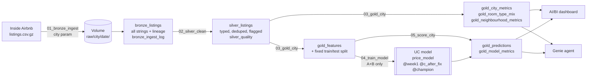

# Team Roalda — Airbnb price analytics (US South)

## Results at a glance

- **The model works where it was trained:** test-set MAE **$82** per night vs **$118** for the median baseline (−30%), in New Orleans and Asheville.
- **The pipeline transferred to a new city unchanged:** Nashville ran end to end on the first try, with no code changes.
- **The model transferred only partly:** on Nashville the first-run error was **$134** (1.6× the training cities), still better than the baseline ($152).
- **Why:** Nashville is a large-group market — a third of its listings sleep 9+ guests vs 12% in the training cities, and large listings are hard to price everywhere.
- **After retraining with 80% of Nashville**, the error on the untouched 20% fell from **$142 to $108** (−24%). A simple price-level correction did not help.

## Cities and data

| Role | City | Inside Airbnb slug | Snapshot date |
|---|---|---|---|
| City A (training) | New Orleans, LA | `new-orleans` | 2026-09-16 |
| City B (training) | Asheville, NC | `asheville` | 2026-09-19 |
| City C (new client) | Nashville, TN | `nashville` | 2026-09-19 |

Region: **US South**, currency **USD**. Data: [Inside Airbnb](https://insideairbnb.com/get-the-data/) `listings.csv.gz`, CC BY 4.0.
Runs entirely on Databricks Free Edition (serverless), at no cost.

**Why Nashville as city C:** a large, event-driven market (concerts, group and bachelorette trips) whose mix of large group listings and price levels likely differs from both training cities, so it tests whether the pipeline and model transfer.

**Key data facts** (all listings, from `silver_quality`):

| | New Orleans | Asheville | Nashville |
|---|---|---|---|
| Listings | 7,263 | 2,865 | 10,133 |
| Without a price | 14.8% | 10.5% | 8.0% |
| 30+ night minimum stay | 40.8% | 8.6% | 13.1% |
| Price p99.5 | ≈ $2,000 | ≈ $2,000 | $2,710 |

`host_since` and `instant_bookable` are present in the files but 100% empty in all three snapshots, so they are not used.
Full exploratory analysis and leakage review: `notebooks/00_eda_A_B.py`.

## Architecture



- **Bronze** — the published file, unchanged: every column a string, plus `city`, `snapshot_date`, `source_file`, `ingested_at`. Purpose: replay without re-downloading.
- **Silver** — one row per listing, typed with `try_cast`, deduplicated, with quality flags (`price_flag`, `is_monthly`, `room_type_known`) instead of silent drops. `silver_quality` records per-city data-quality numbers.
- **Gold** — what consumers need: metrics for the dashboard and Genie, model features with a fixed split, predictions and model metrics.

All tables live in `workspace.airbnb` and are partitioned by `city`; every write replaces only its own city, so runs are idempotent and cities are independent. **One pipeline, city as a parameter:** adding a city means passing a new `city` value, never copying code.

## Repository

```
notebooks/
  common.py                  config, helpers, feature list, baseline (shared; no city-specific code)
  00_eda_A_B.py              exploratory analysis + leakage review (cities A and B only)
  01_bronze_ingest.py        download + land raw file          (param: city, snapshot_date, download)
  02_silver_clean.py         type, clean, flag                  (param: city)
  03_gold_city.py            metrics + features + split         (param: city)
  04_train_model.py          baseline, CV model choice, test-set evaluation, UC registration
  05_score_city.py           predictions for any city           (param: city, model_alias, run_label)
  06_city_c_diagnose.py      city C first-run diagnosis         (param: city, run_label)
  07_city_c_model_change.py  city C model changes, evaluated on held-out 20% (param: city)
jobs/jobs.yml                Job 1 per-city pipeline, Job 2 week-1 run
jobs/job3_new_city.yml       Job 3 for a new city (default city = nashville)
docs/                        dashboard export + queries, Genie setup, column cheat-sheet, week-2 runbook
```

## How to run

1. In Databricks: **Workspace → Create → Git folder** with this repository.
2. Create **Job 1** (`airbnb_city_pipeline`) from `jobs/jobs.yml`, replace `<REPO>`. Note its job id.
3. Create **Job 2** (`airbnb_train_week1`), replace `<REPO>` and `<JOB_1_ID>`, run it. It runs the pipeline for New Orleans and Asheville, trains, and scores both.
4. Run `00_eda_A_B`.
5. New city: create **Job 3** from `jobs/job3_new_city.yml` and run it with `city=<slug>`, `model_alias=week1`, `run_label=c_first_run`; then run `06_city_c_diagnose` and `07_city_c_model_change`.
6. If the download is blocked, upload `listings.csv.gz` to `/Volumes/workspace/airbnb/raw/<city>/<YYYY-MM-DD>/` and run Job 1 with `download=false`.

## Model (week 1)

- **Target:** `price` (USD/night on the snapshot date); trained on log price, converted back.
- **Split:** deterministic 80/20 by hash of listing `id`, fixed in gold before any modelling. Every number below is on the 20% test set.
- **Baseline:** median training price by `room_type × accommodates` (fallback: room type, then global).
- **Model choice:** 5-fold CV on training rows only, among Ridge and gradient boosting variants. Gradient boosting won clearly (CV MAE ≈ $72 vs ≈ $87 for Ridge); chosen: `hgb_lr0.1_l31`.
- **Features (23):** size (accommodates, bedrooms, beds, bathrooms, shared bath), distance to the city's centre, minimum nights, amenities, host, reviews, room and property type.
- **Excluded for leakage:** `estimated_revenue_l365d` (computed from price), `review_scores_value` (guests' judgement of price), availability and estimated occupancy (driven by bookings, which depend on price). Neighbourhood names are not used because they differ in every city.
- **Most important features** (permutation importance): bathrooms, minimum nights, accommodates, bedrooms, distance to centre.

| Test-set MAE (USD) | New Orleans | Asheville | A + B |
|---|---|---|---|
| Baseline | 117 | 120 | 118 |
| Model | 80 | 87 | 82 |

Median absolute error is $36–41 at a median price of $200–216; the mean is pulled up by a few very expensive listings (without price outliers the MAE is $70–72).

## City C report: Nashville

### What we expected to break (committed before the first run, from A and B only)

| Expectation | What happened |
|---|---|
| Listings larger than anything in training | **No:** none exceed the training maximum (16 guests). But large listings are far more common — 34% sleep 9+ vs 12% in the training test sets. |
| A different price level → systematic under-pricing | **Partly:** median price $297 vs $206, but the size features already explain most of it; the remaining level shift is only 3%. |
| A different mix of 30+ night rentals changes what `minimum_nights` means | **Yes, different mix** (13% vs 41% in New Orleans and 9% in Asheville), but 30+ night listings were priced well (MAE $52); the error is in short stays. |
| Rare or unseen property types | **Small:** 1.6% of listings, but badly priced (MAE $207). |
| Column types differ between cities and break a table write | **Yes**, when writing the retrained model's predictions (see change 1). |

### First run (unchanged pipeline, frozen model `week1`)

Job 3 (`airbnb_new_city`, `run_label = c_first_run`) **completed without errors**: bronze → silver → gold and scoring all succeeded. 10,133 listings in every layer, the same 90 columns as A and B, no rows lost, no unknown room types. The pipeline needed no changes to run.

| | MAE (USD) |
|---|---|
| Baseline on Nashville (A+B medians), all 9,319 priced listings | 152 |
| Model on A + B (test set) | 82 |
| **Model on Nashville, first run, all priced listings** | **134** |
| Model on Nashville, first run, held-out 20% (1,859 listings) | 142 |
| **Model on Nashville after changes, held-out 20%** | **108** |
| Baseline with Nashville medians, held-out 20% | 153 |

The "after changes" numbers are on a 20% sample of Nashville that was never used for training or for choosing the change, so the first-run model is also shown on that same sample ($142).

### Where the first run went wrong

- **Large group listings:** 13+ guests MAE $468 (under-priced by $205 on average, 679 listings); 9–12 guests MAE $166.
- **Very expensive listings:** the 394 listings above $1,000 a night (4%) are under-priced by about $850 and account for roughly 28% of all the error.
- **City centre:** listings within 2 km of the centre are under-priced by $122 on average.
- **Hotel rooms:** MAE $166, under-priced by $135 (73 listings).
- **Mainstream listings transfer well:** for $100–499 a night the error rises only moderately (e.g. $74 vs $51 for $200–299).
- **Overall:** the model under-prices by $37 a night on average.

### Changes

| # | Change | Kind | Reason | Result |
|---|---|---|---|---|
| 1 | Cast columns to the types the existing table already has before writing (`is_monthly` was integer for one city, decimal for another) | pipeline fix | a schema difference between cities broke the write of the retrained predictions to `gold_predictions` | writes succeed for any city |
| 2 | Multiply week-1 predictions by 1.03 (median actual / predicted on 80% of Nashville) | model change | test whether the gap is just a higher price level | $142 → $143: no gain, so the gap is not a uniform price level |
| 3 | Retrain on New Orleans + Asheville + 80% of Nashville, same features and settings | model change | Nashville has far more large group listings than the model saw in training | $142 → **$108** (−24%) |

Cost of change 3 for the training cities: New Orleans $80 → $82, Asheville $87 → $88 — a small loss for a large gain on the new client.

### Why Nashville is still worse than the training cities ($108 vs $82)

The error for a listing of a given size is similar across cities — large listings are hard to price everywhere (13+ guests: MAE ≈ $470–490 in all three cities). What differs is the mix: a third of Nashville's listings sleep 9+ guests. With the training cities' size mix, Nashville's first-run error would have been about $101 instead of $134, so roughly two-thirds of the gap comes from what Nashville's market looks like, not from a broken pipeline. A single correction factor cannot fix it, because the model over-prices cheap listings and under-prices expensive ones at the same time; showing it Nashville's own large listings can.

**For the next client:** expect the first-run error to depend on how many large and luxury listings the city has; check the size mix before promising accuracy, and plan to retrain with a sample of the new city.

## Dashboard and Genie

- AI/BI dashboard: [link](https://dbc-58a977cc-a9a9.cloud.databricks.com/dashboardsv3/01f1de099d101a12917f41bc93d72c36/published?o=7474650486058939). Definition: `docs/dashboard.lvdash.json` (Dashboards -> Create -> Import to rebuild it); SQL of every dataset: `docs/dashboard_queries.sql`.
  1. **City overview** — listings, median price, availability, review scores, hosts, room-type mix and neighbourhoods for the selected city.
  2. **Cross-city: New Orleans vs Asheville** — Asheville is about $28 a night pricier ($225 vs $197 median), but 40.8% of New Orleans listings are 30+ night rentals vs 8.6% in Asheville.
  3. **Model** — the four MAE numbers, predicted vs actual, error by room type and neighbourhood, and the most under- and over-priced listings. The `run_label` filter switches between `week1`, `c_first_run` and `c_after_fix` (Nashville). `error = predicted_price - price`, so negative means the model under-prices.

- Genie Agent: [Airbnb Gold Data Insights and Predictive Analytics](https://dbc-58a977cc-a9a9.cloud.databricks.com/genie/rooms/01f1de1512c9101fa4d6edc3cd687797?o=7474650486058939)


## Presentation

TODO: link or `presentation.pdf`.

## Team contributions

| Member | Contribution |
|---|---|
| Anastasiia Liubenchuk | Databricks setup, parameterised pipeline (bronze/silver/gold), Jobs 1–3, first run on Nashville |
| Anastasiia Yablunovska | Exploratory analysis and leakage review, AI/BI dashboard |
| Daryna Nychyporuk | Price model: baseline, model choice, test-set evaluation, Nashville diagnosis and model changes |
| Tetiana Moroz | Genie agent, presentation, README |
